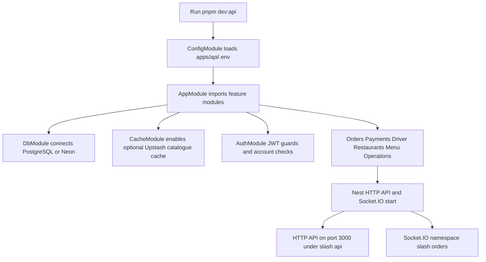
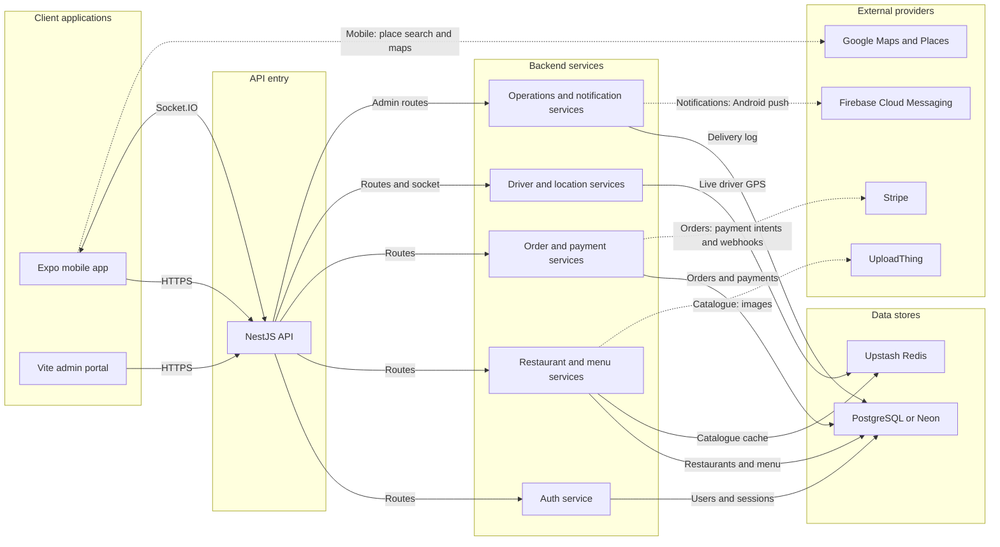
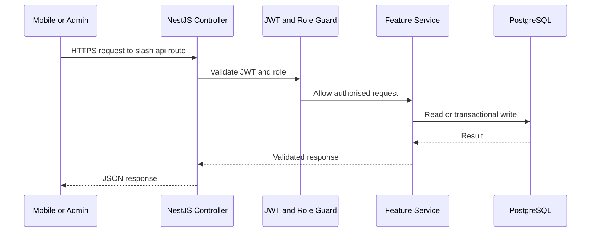
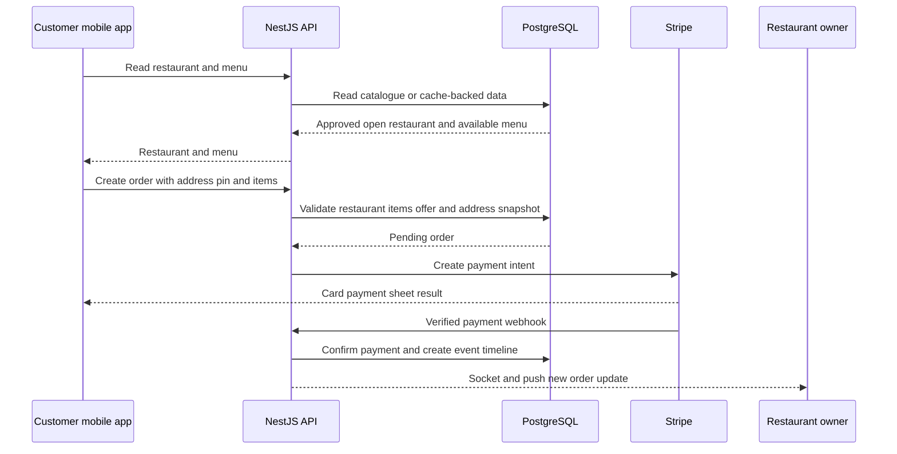
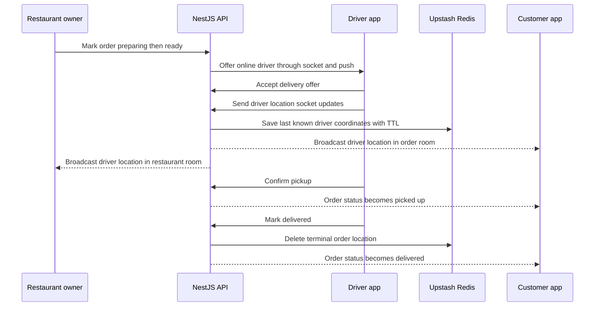
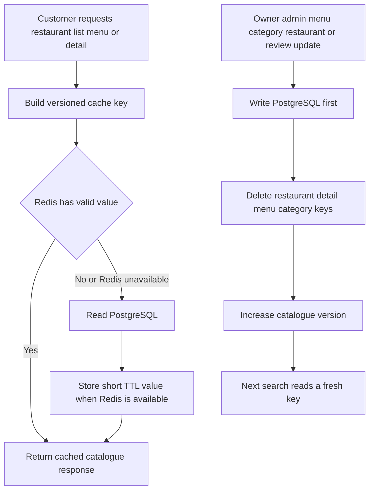
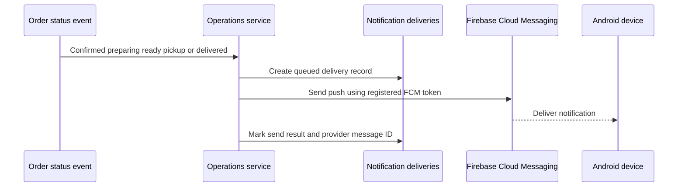

# Wasil NestJS Setup and Connection Flow

This document describes the backend as it is wired in this repository. It is
for developers who need to run, debug, or extend the food-delivery flow.

## 1. Backend startup flow



## 2. System connection architecture



## 3. Required environment connections

Copy the example first:

```bash
cp apps/api/.env.example apps/api/.env
```

| Variable group | Used by | Why it is needed |
| --- | --- | --- |
| `DATABASE_URL` | `DbModule` | Persistent users, restaurants, orders, payments, audit history |
| `JWT_SECRET` | `AuthModule` | Signs and validates authenticated API/socket requests |
| `UPSTASH_REDIS_REST_URL`, `UPSTASH_REDIS_REST_TOKEN` | Location and cache services | Short-lived driver GPS and public catalogue cache |
| `STRIPE_SECRET_KEY`, `STRIPE_WEBHOOK_SECRET` | `PaymentsService` | Creates/validates card payments and refunds |
| `UPLOADTHING_TOKEN` | Upload router | Authorises restaurant/menu uploads |
| `GOOGLE_WEB_CLIENT_ID` | Auth service | Verifies Google sign-in IDs |
| `FIREBASE_PROJECT_ID`, `FIREBASE_SERVICE_ACCOUNT_FILE` | FCM service | Sends direct Android FCM notification updates |
| `CORS_ORIGINS`, `SOCKET_CORS_ORIGIN` | Nest HTTP/socket setup | Allows only configured browser origins in production |

Secrets stay in `apps/api/.env` locally and deployment secret storage in
production. Never commit the values.

## 4. API request lifecycle



All controller DTOs pass through Nest `ValidationPipe` with whitelist and
forbid-unknown-field behavior. Authorization is repeated in services for
ownership-sensitive actions such as address edits, restaurant updates, and
driver location.

## 5. Customer cart and payment flow



The cart is client state only. An order stores a snapshot of its selected
delivery address, latitude, and longitude. The API is the final authority for
item price, item availability, offers, restaurant opening status, payment, and
order transitions.

## 6. Restaurant, driver, and live location flow



Driver apps request foreground location only during an accepted active
delivery. The gateway verifies driver identity, order assignment, and valid
status before accepting a GPS point. Redis retains only the last point for a
late-joining tracking screen.

## 7. Cache flow and invalidation



| Data | Cached? | Reason |
| --- | --- | --- |
| Public restaurant list/search | Yes, 30s | High read volume; version invalidation covers all searches |
| Restaurant detail | Yes, 120s | Public read-heavy data |
| Menu/categories | Yes, 60s | Public read-heavy data |
| Orders/payments/carts | No | Must always be current and transactional |
| Driver availability/assignment | No | Must be current for dispatch |
| Live driver GPS | Separate TTL record | Real-time last-known location, not catalogue cache |

If Upstash is unavailable, cache calls fail open and PostgreSQL remains the
source of truth.

## 8. Push-notification flow



Customer lifecycle notifications use the `active-order-tracking` Android
channel. The order ID is the notification tag, so each new order status updates
the existing lock-screen/status-bar card instead of creating many stale cards.

## 9. Commands by task

```bash
# Install all workspace dependencies
pnpm install

# Start API
pnpm dev:api

# Apply local schema changes
pnpm --dir apps/api db:push

# Start admin portal
pnpm dev:admin

# Start mobile Metro
pnpm --dir apps/mobile start --dev-client

# Build and install Android development app
pnpm --dir apps/mobile android

# Build and install iOS development app
pnpm --dir apps/mobile ios

# Backend tests and checks
pnpm --dir apps/api lint
pnpm --dir apps/api exec tsc --noEmit
pnpm --dir apps/api test

# Full project verification
pnpm verify
```

## 10. Debug checklist

| Problem | Check first |
| --- | --- |
| Mobile cannot reach API | API running; phone and Mac same Wi-Fi; `EXPO_PUBLIC_DEV_HOST` correct; restart Metro |
| Driver not visible | Driver active/online; accepted the order; location permission granted; order must be `READY` or `PICKED_UP` |
| Old restaurant/menu data | Verify owner/admin write completed; Redis credentials valid; refresh after invalidation |
| Push shows no token | Use installed development/release app, not Expo Go; allow notifications; verify API LAN URL |
| FCM delivery fails | API Firebase project/service account match `google-services.json`; restart API after environment change |
| Admin cannot sign in | User is active and role is `ADMIN`; use documented bootstrap only for first admin |
