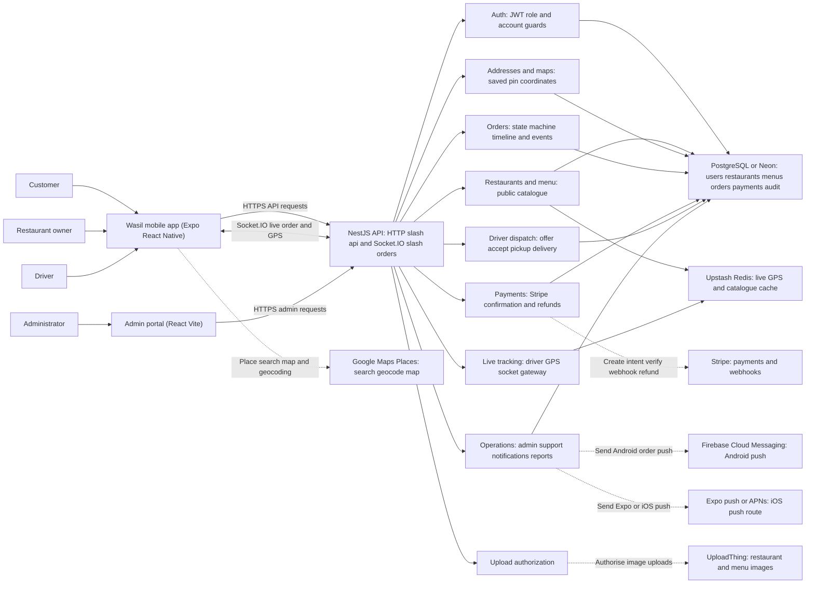
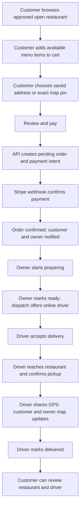

# Wasil Complete Project Flow

This is the whole-system view: who uses each app, where requests go, what is
stored, and which events update other users in real time.

## Complete connection map



## How to read the map

1. The Customer, Owner, and Driver use the same mobile app with role-specific
   routes after login.
2. The Admin uses the separate browser portal.
3. Every protected request first passes JWT/account/role checks.
4. Business services write permanent records to PostgreSQL/Neon.
5. Redis is only for fast, temporary data: last driver GPS and public catalogue
   cache. It is never the source of truth for payments or orders.
6. Socket.IO sends live order/GPS events while an app is open.
7. FCM/Expo/APNs sends push updates when an app is backgrounded or locked.

## Whole order journey



## Who receives which update

| Event | Customer | Restaurant owner | Driver | Admin |
| --- | --- | --- | --- | --- |
| Payment confirmed | Tracking status/push | New order socket/push | — | Order visible |
| Preparing | Status/push | Own dashboard | — | Timeline visible |
| Ready | Status/push | Own dashboard | Driver offer | Timeline visible |
| Driver accepts | Rider assigned status | Driver progress | Active delivery | Timeline visible |
| Driver GPS | Smooth moving map pin | Pickup progress map pin | Own location | Operations data |
| Picked up | On-the-way status/push | Order progress | Delivery route | Timeline visible |
| Delivered | Delivered status/push/review | Completed order | Delivery finished | Settlement/report data |
| Cancel/refund | Cancellation/refund status | Intervention result | Offer revoked if relevant | Full audit/support record |

## Data ownership

| Data | Owner/source of truth | Used by |
| --- | --- | --- |
| Accounts, roles, status | PostgreSQL `user` records | All applications |
| Restaurant/menu/location | PostgreSQL, owner/admin writes | Customer catalogue, owner, driver pickup |
| Saved customer address | PostgreSQL `user_addresses` | Customer checkout; copied to order snapshot |
| Order/address/total/status | PostgreSQL `orders` and timeline | All role-specific order screens |
| Payment/refund | Stripe + PostgreSQL payment records | Customer, admin finance |
| Driver current GPS | Upstash Redis with TTL | Customer/owner live maps |
| Restaurant catalogue cache | Upstash Redis short TTL | Customer discovery and menu reads |
| Push token/delivery history | PostgreSQL | Notification sender/admin delivery log |

## Runtime commands

```bash
# API
pnpm dev:api

# Admin browser portal
pnpm dev:admin

# Mobile Metro for installed development build
pnpm --dir apps/mobile start --dev-client

# Android native build/install after native config changes
pnpm --dir apps/mobile android

# iOS native build/install
pnpm --dir apps/mobile ios

# Validate the full repository
pnpm verify
```

For a physical phone, point `EXPO_PUBLIC_DEV_HOST` in `apps/mobile/.env` to
the Mac LAN IP and restart Metro.
